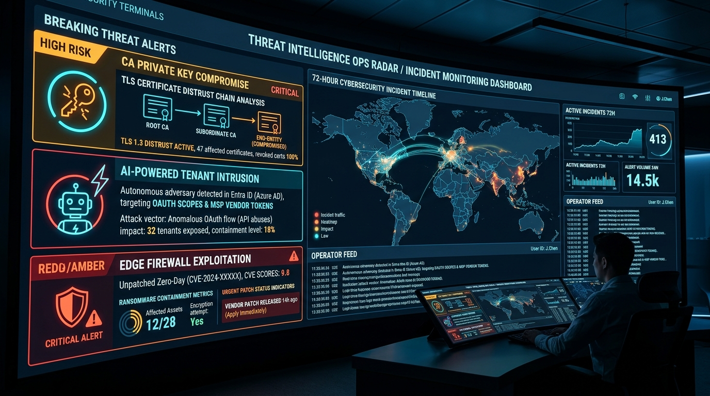

<div align="center">

<h1>🛡️ Black October</h1>

<p><strong>Production-tested Security Skills for AI Agents & Engineers<br/>Patch triage · CA migration · OAuth audit · Incident response · Code review · Threat briefs</strong></p>

<p align="center">
  
</p>

[](tests/test_scripts.py)
[](evals/evals.json)
[](tests/mutation_check.py)
[](LICENSE)
[](requirements.txt)
[](#-supported-tools--platforms)

<p>Works with <strong>Claude.ai</strong>, <strong>Claude Code</strong>, <strong>Cursor</strong>, <strong>Windsurf</strong>, <strong>GitHub Copilot</strong>, <strong>Cline</strong>, <strong>Roo Code</strong>, <strong>Aider</strong>, <strong>Google Antigravity</strong>, and any client that supports <a href="https://docs.claude.com"><code>SKILL.md</code> Agent Skills</a> (plus standalone CLI & CI/CD).<br/>
Minimum dependency footprint: Python 3 stdlib · <code>cryptography</code> (cert audit only)</p>

<a href="#-the-six-skills">Skills</a> ·
<a href="#-supported-tools--platforms">Supported Tools</a> ·
<a href="#-install">Install</a> ·
<a href="#-usage-examples">Usage</a> ·
<a href="#-benchmarks">Benchmarks</a> ·
<a href="#-black-october-what-triggered-this">Motivation</a> ·
<a href="#-faq">FAQ</a> ·
<a href="CONTRIBUTING.md">Contributing</a>

---

</div>

## 🧠 What This Is

AI cannot block attacks. But AI can **speed up the repeatable analysis work around security operations** — the parts where humans forget steps under pressure, prioritize wrong, or get overwhelmed by volume.

This repo pairs **six written `SKILL.md` procedures** (instructions agents follow like a senior analyst) with **deterministic Python helper scripts** (where the output must be reproducible and auditable). Every helper is covered by unit tests, eval assertions, and mutation testing.

> **Rule of thumb:** if an agent's output must be reproducible, it goes through a script. If it requires judgment and synthesis, it goes through a `SKILL.md`.

---

## 🔥 Black October: What Triggered This

<p align="center">
  
</p>

In the **72 hours before October 24, 2026** ("Black October"), three unconnected incidents demonstrated the exact failure modes these skills are designed around:

<details>
<summary><strong>1. 🔑 eMudhra intermediate CA key compromise — cert-inventory-migration</strong></summary>

Eight eMudhra intermediate CA private keys were compromised, requiring browser vendors to distrust the associated certificates. Security teams scrambled to:
- Find every certificate in their estate chaining to the affected intermediates
- Identify certificates signed using the affected SPKI
- Plan emergency reissue across TLS, code-signing, and device certs
- Check Certificate Transparency logs for forged certs on their domains

**Coverage:** `cert-inventory-migration` — flags `DISTRUSTED_ISSUER`, `DISTRUSTED_IN_CHAIN`, `DISTRUSTED_SPKI`, `WEAK_RSA`, and `EXPIRED` on local PEM files. Provides an ordered migration plan and verification checklist.

Sources: [The Hacker News](https://thehackernews.com/2026/10/eight-emudhra-ca-keys-compromised.html) · [Google Security Blog](https://blog.google/security/protecting-chrome-and-android-users-from-compromised-emudhra-intermediate-ca-certificates/) · [Help Net Security](https://www.helpnetsecurity.com/2026/10/21/emudhra-certificates-private-keys-compromised/)

</details>

<details>
<summary><strong>2. 🤖 China-linked APT uses AI pentest tool "Artex" in ConnectWise-style tenant attacks — oauth-vendor-access-audit</strong></summary>

A China-nexus threat actor was observed using an AI-assisted penetration testing tool ("Artex") in attacks exploiting ConnectWise-style remote management software, compromising MSP and vendor access to downstream tenants. The attack vector: **over-privileged OAuth apps and delegated admin relationships** with no MFA enforcement, stale credentials, and admin-consented multi-tenant app registrations.

**Coverage:** `oauth-vendor-access-audit` — flags `HIGH` risk scopes (Directory.ReadWrite, Mail.ReadWrite), unverified publishers, admin-consented multi-tenant apps, accounts with no MFA or no owner, recently-added credentials (persistence indicator), and unused apps.

Sources: [SecurityWeek](https://securityweek.com/china-apt-uses-ai-pentest-tool-artex-in-connectwise-attacks)

</details>

<details>
<summary><strong>3. 🔥 Hackers breach enterprise firewalls and VPNs — patch-triage + incident-response-runbook</strong></summary>

Ransomware affiliates exploited unpatched edge devices (Fortinet FortiOS, Palo Alto PAN-OS) to gain initial access, then moved laterally via initial-access-broker tooling (Rclone, Cobalt Strike). Multiple enterprise networks were encrypted within hours of initial breach. The pattern: internet-exposed devices running software with known CVEs, patching delayed past the exploitation window.

**Coverage:** `patch-triage` — deterministic P0/P1/P2/P3 scoring that bumps edge devices one severity level up, so exploited + exposed = P0 (fix in 24h) regardless of nominal severity. `incident-response-runbook` — covers ransomware containment without a "pay by default" path.

Sources: [The Hacker News](https://thehackernews.com/2026/10/hackers-breach-enterprise-firewalls-and.html)

</details>

---

## 🎯 Who This Is For

| Role | How they use it |
|---|---|
| 🔵 **SOC / Blue Team Analysts** | Triage incoming CVEs and advisories without missing P0s; run incident response without forgetting steps |
| 🔧 **Security Engineers** | Audit certificate estates and OAuth app registrations systematically |
| 🏗️ **DevSecOps / Developers** | First-pass code and config security review before formal SAST |
| 🏢 **IT / Platform Admins** | Own patching, PKI, and SaaS access; respond to CA distrust or supply-chain alerts |
| 👥 **Small Teams** | No dedicated security staff? Get a repeatable baseline process that your AI assistant can walk you through |
| 🤝 **MSPs / Vendor-Risk Owners** | Audit third-party OAuth access and delegated admin relationships |

---

## 🔧 The Six Skills

<p align="center">
  
</p>

### 🩹 `patch-triage` — Deterministic CVE Prioritization

**Problem:** Scanner dumps 400 CVEs. Which 3 need a P0 response tonight?

**How it works:** Your AI agent searches live sources (CISA KEV, vendor advisories) for exploitation status, then the `triage.py` script applies deterministic priority rules:

| Condition | Priority | Deadline |
|---|---|---|
| Exploited AND internet-exposed (or unauth RCE) | **P0** | 24 hours |
| Exploited OR PoC public, OR exposed + critical | **P1** | 72 hours |
| Critical/High, internal only | **P2** | 14 days |
| Everything else | **P3** | Next cycle |

Edge devices (VPNs, firewalls, load balancers) move **one level up** automatically.

```bash
python skills/patch-triage/scripts/triage.py vulns.csv --format json
# CSV columns: cve,asset,product,exploited,internet_exposed,severity,patch_available,edge_device
```

**Example prompt:**
> "Here is our Tenable export. What do we patch first? Our Fortinet gateways are internet-facing."

---

### 🔑 `cert-inventory-migration` — CA Compromise & Certificate Estate

**Problem:** A CA was distrusted. Which of our certs are affected? What do we do first?

**How it works:** `cert_audit.py` walks local PEM files and flags:

| Flag | Meaning |
|---|---|
| `DISTRUSTED_ISSUER` | Cert issued directly by the compromised CA |
| `DISTRUSTED_IN_CHAIN` | Intermediate in chain traces to compromised root |
| `DISTRUSTED_SPKI` | Cert matches SPKI hash from incident notice |
| `EXPIRED` / `EXPIRES_SOON` | Expired or expiring within 30 days |
| `WEAK_RSA` | RSA key < 2048 bits |
| `WEAK_SIGNATURE` | MD5 or SHA-1 signature |

```bash
python skills/cert-inventory-migration/scripts/cert_audit.py ./certs \
  --distrust "eMudhra" \
  --spki-hash <hex-from-incident-notice> \
  --json

# Exit code 1 if any distrusted cert found — CI-friendly
```

> ⚠️ The script cannot detect low-entropy keys. Use the CA's published list of affected key ranges for those.

**Example prompt:**
> "A CA we use just had a key compromise. Find our affected certificates and plan the reissue."

---

### 🏢 `oauth-vendor-access-audit` — Supply-Chain & OAuth Risk

**Problem:** ConnectWise-style attack via MSP. Which OAuth apps and vendor accounts are dangerous?

**How it works:** `audit_apps.py` reads a JSON export of your app registrations and scores each app HIGH / MEDIUM / LOW, flagging:

- High-risk Graph scopes: `Directory.ReadWrite`, `Application.ReadWrite`, `RoleManagement.ReadWrite`, `Mail.ReadWrite`, `full_access`
- Unused apps (>90 days), no owner, unverified publisher
- Admin-consented multi-tenant apps
- Long-lived secrets (>365 days), recently added credentials (persistence indicator)
- Delegated admin relationships with no MFA

```bash
python skills/oauth-vendor-access-audit/scripts/audit_apps.py apps.json \
  --today 2026-10-24 \
  --json
```

**Example prompt:**
> "Audit our Entra app registrations after the ConnectWise-style supply-chain news. We want everything ranked by risk."

---

### 🚨 `incident-response-runbook` — Ransomware, Breaches, Leaks

**Problem:** Ransomware on 40 file servers. What do I do right now and in what order?

**Phases covered:**

1. **Contain** — isolate hosts (network segment, not power-off), disable accounts, revoke tokens, block IOCs
2. **Preserve Evidence** — logs, disk/memory images, timeline, chain of custody
3. **Scope** — initial access vector, lateral movement, data exfiltrated
4. **Eradicate** — remove persistence, patch entry point, rotate all credentials
5. **Recover** — restore from verified clean backups, monitor for re-entry
6. **Notify** — legal, regulators, insurers; deadline lookup enforced (no hardcoded values)
7. **Review** — root cause, timeline, remediation owners

> **Ransomware-specific:** Never pay by default. Check for public decryptors first. Confirm backup integrity before restore. Assume data theft if a leak-site listing exists.

**Example prompt:**
> "Ransomware encrypted about 40 file servers 2 hours ago. What do I do right now?"

---

### 🔍 `security-config-code-review` — Secrets, Crypto, Exposure

**Problem:** Does this PR introduce a security issue? What's wrong with our infra config?

**Checks 9 rule classes:**

| Rule | Detects |
|---|---|
| `AWS_ACCESS_KEY` / `GITHUB_TOKEN` / `PRIVATE_KEY` | Hardcoded credentials |
| `WEAK_RANDOM_FOR_SECRET` | `Math.random()`, `rand()`, `random.randint()` used for tokens | <!-- scan:ignore -->
| `WEAK_HASH` | MD5, SHA1 in security contexts |
| `TLS_VERIFY_DISABLED` | `verify=False`, `InsecureRequestWarning` | <!-- scan:ignore -->
| `DEBUG_ENABLED` | `app.run(debug=True)` | <!-- scan:ignore -->
| `OPEN_TO_WORLD` | `0.0.0.0/0` security group rules |
| `PERMISSIVE_CHMOD` | `chmod 777` | <!-- scan:ignore -->

```bash
python skills/security-config-code-review/scripts/scan.py . \
  --exclude tests \
  --fail-on HIGH     # CI-friendly: exits 1 if any HIGH+ finding

# Add `scan:ignore` on a line to suppress a confirmed false positive
```

> Not a replacement for SAST or dedicated secret-scanning products. Treats findings as leads to investigate, not verdicts.

**Example prompt:**
> "Review this repo for security problems before we open-source it."

---

### 📰 `threat-advisory-summarizer` — One-Screen Actionable Briefs

**Problem:** 12-page CISA advisory. Are we affected? What exactly do we do?

**Output format per advisory:**

1. **One-line summary** — what happened
2. **Impact on you** — Affected / Not affected / Unknown / Possibly
3. **Actions** — Now / 72h / Later, with exact versions and settings
4. **Key IOCs or log queries** — if available
5. **Sources** — confirmed facts vs vendor claims vs speculation, clearly separated

**Example prompt:**
> "Summarize this CISA advisory for a team running Fortinet FortiOS 7.4. Are we affected?"

---

## ⚡ Install

### 🛠️ Supported Tools & Platforms

Because every skill follows the open **`SKILL.md`** specification and includes standalone Python CLI scripts, this repo works across all major AI agent clients and IDEs:

| Tool / Client | Support Level | How to Use |
|---|---|---|
| **Claude Code** | Native Agent Skill | Copy to `~/.claude/skills/` (global) or `.claude/skills/` (repo-level) |
| **Claude.ai** | 1-Click Upload | Download `.skill` bundles from [`releases/`](releases/) and upload in Claude Settings |
| **Cursor** | Native / Rules | Copy to `.cursor/skills/` or reference `SKILL.md` in `.cursorrules` |
| **Windsurf** | Native / Cascade | Reference `SKILL.md` in `.windsurfrules` or project workflows |
| **GitHub Copilot** | Agent Mode | Reference in `.github/copilot-instructions.md` or Copilot Chat prompt |
| **Cline / Roo Code** | Custom Instructions | Add `SKILL.md` path to Custom System Instructions or `.clinerules` |
| **Aider** | Pair Programming | Run `aider --read skills/<skill-name>/SKILL.md` |
| **Google Antigravity** | Workspace Skills | Copy to `.agents/skills/` or `~/.gemini/config/skills/` |
| **CLI & CI/CD** | Deterministic Scripts | Run directly in terminal, GitHub Actions, or GitLab CI (no LLM required) |

---

### Claude.ai (No-code)

Download the `.skill` files from [`releases/`](releases/) and upload them in Claude's skills settings.

```
releases/
├── patch-triage.skill
├── cert-inventory-migration.skill
├── oauth-vendor-access-audit.skill
├── incident-response-runbook.skill
├── security-config-code-review.skill
└── threat-advisory-summarizer.skill
```

### Claude Code (CLI)

```bash
git clone https://github.com/ashp15205/black-october.git
cd black-october

# Install skills globally (personal) or per-project
mkdir -p ~/.claude/skills
cp -r skills/* ~/.claude/skills/

# Only needed for cert_audit.py (cryptography library)
pip install -r requirements.txt
```

### Cursor & Windsurf

```bash
# Cursor: Add to project skills directory or .cursorrules
mkdir -p .cursor/skills
cp -r skills/* .cursor/skills/

# Windsurf: Reference skills/<name>/SKILL.md in .windsurfrules
```

### GitHub Copilot, Cline, Roo Code & Aider

- **GitHub Copilot**: Reference the relevant `skills/<skill-name>/SKILL.md` in `.github/copilot-instructions.md` or in your prompt.
- **Cline / Roo Code**: Add skill paths into your system instructions or `.clinerules`.
- **Aider**: Pass `--read skills/<skill-name>/SKILL.md` when launching aider.
- **Standalone CLI / CI/CD**: Run Python helper scripts (`scan.py`, `cert_audit.py`, `audit_apps.py`) directly with `--json` in CI workflows.

### Verify Installation

```bash
python3 scripts/quick_validate.py
# ✅ All 6 skills valid
```

---

## 💬 Usage Examples

Skills are triggered by your natural language request in your AI agent (Claude, Cursor, Copilot, etc.). No special syntax required.

```
"Here is our scanner export. What do we patch first?
 Treat VPN gateways as internet-facing."

"A CA we use just had a key compromise.
 Find our affected certificates and plan the reissue."

"Audit our Entra app registrations after the ConnectWise supply-chain news."

"Ransomware encrypted about 40 file servers. What do we do right now?"

"Review this repo for security problems before we open-source it."

"Summarize this CISA advisory for a team running NetScaler 14.1."
```

---

## 📊 Benchmarks

```bash
python evals/run_evals.py   # runs in ~0.2s
```

| Check | Result |
|---|---|
| Unit tests | **46 / 46** · `-W error::ResourceWarning` |
| Eval assertions (12 cases, 2 per skill) | **40 / 40** (20 script · 20 LLM output) |
| Mutation smoke test | **11 / 11 mutants killed** |
| Dogfood scan (`scan.py --fail-on LOW`, tests/ excluded) | **0 findings** |
| Skill structure validation (`quick_validate.py`) | **6 / 6 valid** |
| Full eval suite runtime | **~0.09–0.4 s** |

**Per-skill eval results:**

| Skill | Assertions |
|---|---|
| patch-triage | 5 / 5 |
| cert-inventory-migration | 5 / 5 |
| oauth-vendor-access-audit | 5 / 5 |
| security-config-code-review | 5 / 5 |
| incident-response-runbook | 10 / 10 |
| threat-advisory-summarizer | 10 / 10 |

### Honest disclosure on what these numbers mean

- **Script evals** execute real scripts on runtime-generated fixtures and grade programmatically. Strongest signal.
- **LLM evals** check saved Claude outputs for required sections, guard-rails ("verify deadlines", no invented CVE numbers). Written by Claude in the same session — a structure check, not an independent quality evaluation. Read `evals/results/` yourself.
- **No A/B comparison**: no with-skill vs without-skill baseline run.
- **Heuristics**: the scanner and cert checks expect false positives/negatives. Mutation testing proves regressions are caught, not that every real-world issue is caught.
- **Synthetic fixtures**: GitHub Actions CI mirrors local commands but badge status depends on GitHub running the workflow after push.

---

## 📁 Repository Layout

```
black-october/
│
├── skills/
│   ├── patch-triage/
│   │   ├── SKILL.md               ← procedure Claude follows
│   │   └── scripts/triage.py      ← deterministic P0-P3 scorer
│   │
│   ├── cert-inventory-migration/
│   │   ├── SKILL.md
│   │   └── scripts/cert_audit.py  ← PEM walker, SPKI matcher
│   │
│   ├── oauth-vendor-access-audit/
│   │   ├── SKILL.md
│   │   └── scripts/audit_apps.py  ← risk scorer, flag engine
│   │
│   ├── incident-response-runbook/
│   │   ├── SKILL.md
│   │   └── assets/timeline-template.md
│   │
│   ├── security-config-code-review/
│   │   ├── SKILL.md
│   │   └── scripts/scan.py        ← regex-based 9-rule scanner
│   │
│   └── threat-advisory-summarizer/
│       ├── SKILL.md
│       └── assets/brief-template.md
│
├── tests/
│   ├── test_scripts.py            ← 46 unit tests
│   ├── fixtures.py                ← runtime fixture generators
│   └── mutation_check.py          ← 11 mutant kill checks
│
├── evals/
│   ├── evals.json                 ← 12 eval cases (2 per skill)
│   ├── run_evals.py               ← runner + benchmark writer
│   └── results/                   ← saved Claude outputs + benchmark.json
│
├── scripts/
│   └── quick_validate.py          ← SKILL.md structure validator
│
├── releases/                      ← packaged .skill files for Claude.ai upload
└── .github/workflows/test.yml     ← CI: tests + mutation + evals + scan
```

---

## 🛡️ Security Design Decisions

**Why deterministic scripts instead of pure LLM?**

LLMs hallucinate. For security triage, a hallucinated CVE severity or a fabricated patch version can cause real harm. Every task where the correct answer can be computed deterministically uses a Python script — the LLM sets up the inputs from context, the script computes the answer.

**Why no network calls in scripts?**

The scripts run fully offline. No telemetry, no API calls, no credentials. Claude handles web lookups (CISA KEV, vendor advisories) as part of the `SKILL.md` workflow; the scripts only process what you provide locally.

**Why `scan:ignore` instead of `.gitignore`-style?**

Suppressions are inline and reviewable in diff. A `scan:ignore` comment on a line makes the decision visible to code reviewers rather than hidden in a config file.

---

## ❓ FAQ

<details>
<summary><strong>Can an AI agent skill prevent cyberattacks?</strong></summary>

No. Prevention comes from architecture decisions, patching, phishing-resistant MFA, least privilege, monitoring, and tested backups. These skills speed up and standardize the analysis and response work around those controls.

</details>

<details>
<summary><strong>Do the scripts send my data anywhere?</strong></summary>

No. All scripts run locally and make zero network calls. Claude itself may search the web for CVE/advisory information when a `SKILL.md` step directs it to.

</details>

<details>
<summary><strong>Is the output legal or compliance advice?</strong></summary>

No. Notification deadlines, breach reporting rules, and similar requirements vary by jurisdiction and change over time. The `incident-response-runbook` skill explicitly tells Claude to verify current requirements via web search rather than quoting fixed values, and instructs you to involve legal counsel.

</details>

<details>
<summary><strong>Can I add my own skill?</strong></summary>

Yes — see [CONTRIBUTING.md](CONTRIBUTING.md). Keep each skill narrow: one problem, one `SKILL.md`, optional `scripts/` and `assets/`. Any script change needs a unit test and, for behavior users depend on, an eval case.

</details>

<details>
<summary><strong>Does Black October only work with Claude?</strong></summary>

No! While originally named for its early development environment and Claude.ai `.skill` packaging, every skill is built on the open `SKILL.md` agent format. It works seamlessly with **Claude.ai**, **Claude Code**, **Cursor**, **Windsurf**, **GitHub Copilot**, **Cline**, **Roo Code**, **Aider**, **Google Antigravity**, and any tool that reads instructions. Furthermore, all deterministic helper scripts (`scan.py`, `cert_audit.py`, `audit_apps.py`) run completely standalone in your terminal or CI/CD pipelines without requiring any AI assistant.

</details>

<details>
<summary><strong>What's the difference between the .skill files and the skill folders?</strong></summary>

The `releases/*.skill` files are packaged for Claude.ai upload (one-click install). The `skills/*/` folders are the source — use them with Claude Code or any SKILL.md-compatible client. They're the same content.

</details>

<details>
<summary><strong>Why mock secrets in tests instead of real ones?</strong></summary>

`tests/fixtures.py` builds synthetic vulnerable files at runtime (fake AWS keys, synthetic GitHub tokens). Nothing real is ever committed. This matches the `CONTRIBUTING.md` rule: never commit real secrets or token-shaped literals.

</details>

---

## 🤝 Contributing

Contributions are welcome from security practitioners, blue teamers, and developers.

```bash
# Run the full check suite before opening a PR
pip install -r requirements.txt
python -W error::ResourceWarning -m unittest tests.test_scripts
python tests/mutation_check.py
python evals/run_evals.py
python scripts/quick_validate.py
python skills/security-config-code-review/scripts/scan.py . --exclude tests --fail-on HIGH
```

See [CONTRIBUTING.md](CONTRIBUTING.md) for full guidelines.

---

## 📰 Reference Incidents (October 2026)

These real-world incidents informed the skill design. Verify all details against primary sources.

| Incident | Skill Coverage | Sources |
|---|---|---|
| eMudhra intermediate CA key compromise — 8 CA private keys compromised, browser distrust | `cert-inventory-migration` | [THN](https://thehackernews.com/2026/10/eight-emudhra-ca-keys-compromised.html) · [Google](https://blog.google/security/protecting-chrome-and-android-users-from-compromised-emudhra-intermediate-ca-certificates/) · [HNS](https://www.helpnetsecurity.com/2026/10/21/emudhra-certificates-private-keys-compromised/) |
| China APT uses AI pentest tool "Artex" in ConnectWise-linked tenant attacks | `oauth-vendor-access-audit` | [SecurityWeek](https://securityweek.com/china-apt-uses-ai-pentest-tool-artex-in-connectwise-attacks) |
| Fortinet / Palo Alto edge device campaign tied to ransomware affiliates | `patch-triage` · `incident-response-runbook` | [THN](https://thehackernews.com/2026/10/hackers-breach-enterprise-firewalls-and.html) |

---

## 📄 License

MIT © 2026 Ashish Patil — see [LICENSE](LICENSE).

---

<div align="center">

**Built in response to real incidents. Tested. Honest about limitations.**

⭐ Star this repo if it helped your team · 🐛 [Open an issue](https://github.com/ashp15205/black-october/issues) · 🤝 [Contribute](CONTRIBUTING.md)

</div>
